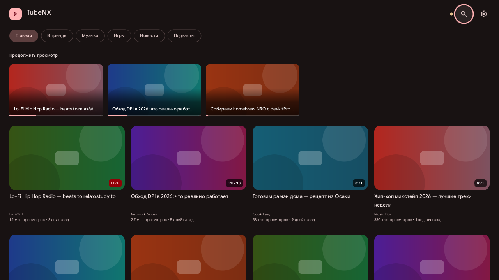
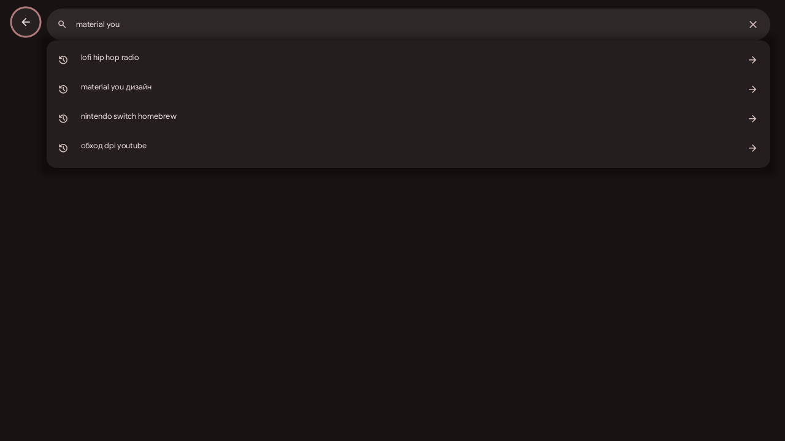
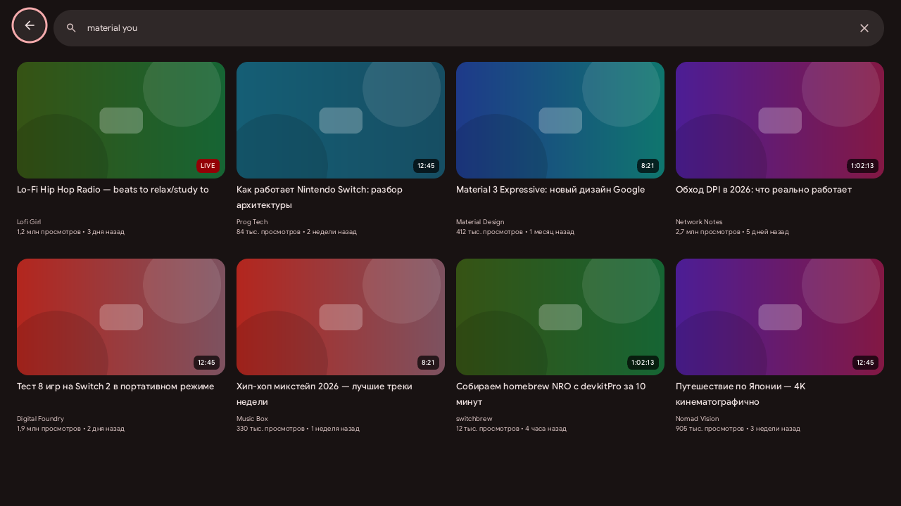
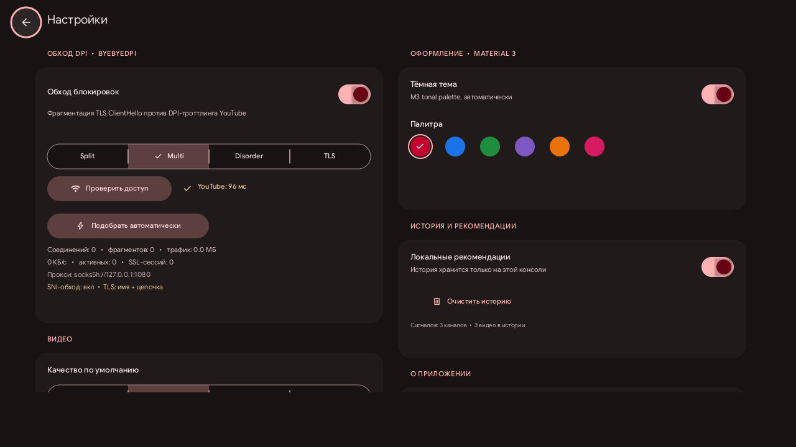
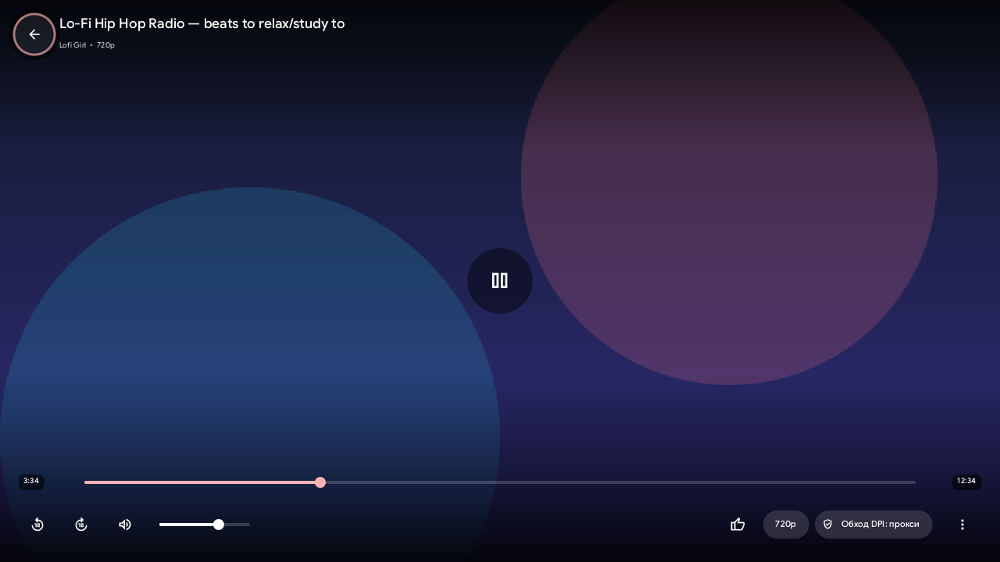
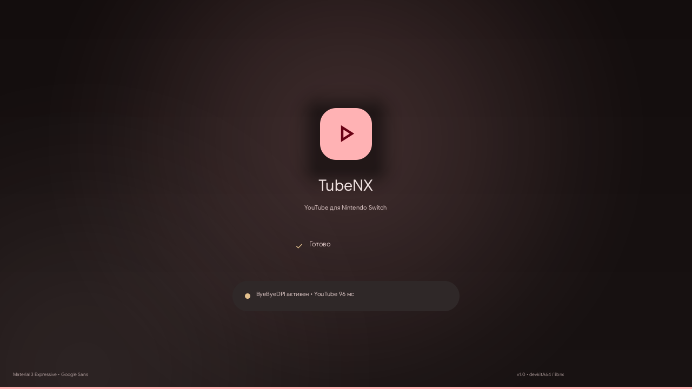
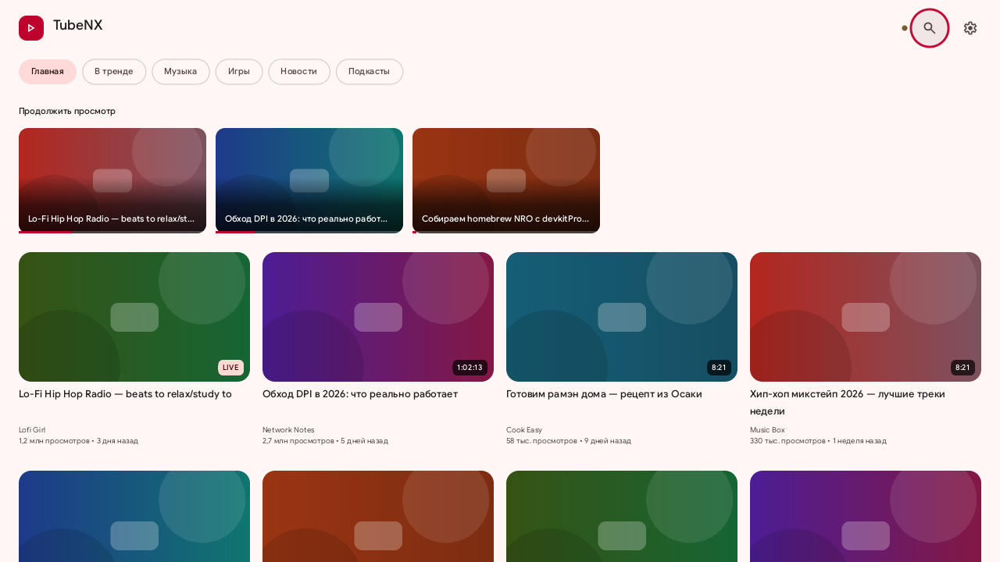

# TubeNX

Неофициальный YouTube-клиент для **Nintendo Switch homebrew**: интерфейс **Material 3**, лента и поиск через InnerTube, программный плеер на **libmpv** и сетевой обход DPI.

> **Ранняя альфа.** Лента и поиск работают при доступной сети. Воспроизведение видео со звуком, перемотка и смена качества реализованы, но сквозной прогон на консоли ещё не подтверждён. Доступность потоков зависит от региона, провайдера и CDN. Аккаунт Google, DRM и платные подписки не поддерживаются.

## Скриншоты

Это **рендеры экранов интерфейса** из того же кода UI, что и в NRO, а не фотографии с консоли.

| Главная | Поиск с подсказками |
|---|---|
|  |  |

| Результаты поиска | Настройки |
|---|---|
|  |  |

| Плеер (видеокадр — заглушка) | Запуск |
|---|---|
|  |  |

Главная в светлой теме — цвета выводятся из seed-цвета:



## Состояние проекта

| Возможность | Статус |
|---|---|
| Сборка `.nro`, запуск из hbmenu, иконка | Работает |
| Интерфейс Material 3, геймпад, тач, курсор, настройки | Реализовано |
| Лента, тренды, поиск и подсказки | Работают при доступной сети |
| Обложки | Частично: отдельные запросы к CDN могут завершиться ошибкой |
| Локальный SOCKS5, обход DPI, внешний прокси | Реализованы; результат зависит от сети и провайдера |
| Плеер libmpv, adaptive-потоки, звук, перемотка | Реализованы; полный прогон на консоли ещё не подтверждён |
| Google-аккаунт, DRM, платные функции | Не поддерживаются |

## Что внутри

| Возможность | Реализация |
|---|---|
| Интерфейс | Собственный software-рендерер RGBA8888 + SDF; UI не зависит от SDL и GPU |
| Дизайн | Material 3: динамические роли из seed-цвета (CAM16/HCT), Google Sans, формы, elevation, ripple, Expressive-компоненты |
| API | InnerTube без собственного API-ключа: главная, тренды, поиск, подсказки, продолжение ленты, потоки |
| Плеер | libmpv: программный вывод кадра, аудио через `hos`/audren, DASH с отдельными видео- и аудиодорожками |
| Сеть | libcurl, локальный SOCKS5, фрагментация TLS ClientHello и HTTP-ретранслятор для плеера |
| Управление | Геймпад, тачскрин, виртуальный курсор, экранная клавиатура Switch |

## Установка

Готовая диагностическая сборка лежит во вкладке [Releases](https://github.com/agafak1337/TubeNX/releases). Скопируйте `TubeNX-diag.nro` в `sd:/switch/` и запустите из hbmenu — аккаунт не нужен.

Учтите: это ранняя диагностическая версия с подробным логом, а не стабильный релиз.

## Сборка

Нужен [devkitPro](https://devkitpro.org/) с devkitA64, libnx и портлибами Switch (`switch-mpv`, `switch-curl`, `switch-jansson`, `switch-ffmpeg`, `switch-sdl2`).

```bash
export DEVKITPRO=/opt/devkitpro
export DEVKITA64=$DEVKITPRO/devkitA64
export PATH=$DEVKITPRO/tools/bin:$DEVKITA64/bin:$PATH

make -j$(nproc)
# → TubeNX.nro
```

Скрипты:

```bash
bash tools/build.sh     # сборка с проверками
bash tools/deploy.sh    # копирование на SD через MTP + sha256
bash tools/pull-log.sh  # забрать свежий лог в logs/
```

## Управление

| Кнопка | Действие |
|---|---|
| Левый стик / D-pad | Навигация по фокусу |
| A | Выбрать / показать контролы в плеере |
| B | Назад |
| X | Поиск |
| Y | Пауза (в плеере) |
| ZR + левый стик | Виртуальный курсор |
| Правый стик | Прокрутка ленты |
| L / R | Перемотка −30 / +30 с (в плеере) |
| Тачскрин | Прямое управление |

## Сеть и обход DPI

TubeNX поднимает локальный SOCKS5 (`127.0.0.1:1080`), подменяет SNI в ClientHello и при необходимости отправляет первые байты фрагментами, чтобы DPI не увидел целой сигнатуры. Для `youtube.com`/`ytimg.com` используется SNI в верхнем регистре, для `googlevideo.com` — разрешённое имя с сохранением настоящего `Host`.

Режимы фрагментации (Настройки → Обход DPI): `Split` (2 байта + остаток), `Multi` (6 фрагментов с паузами), `Disorder` (обратный порядок), `TLS` (по границам TLS-записей).

Плеер получает видео с локального HTTP-ретранслятора `127.0.0.1:8899` — он нужен потому, что ffmpeg в портлибах собран без TLS, и он же обслуживает `Range` для перемотки и смены качества.

Если провайдер блокирует CDN по IP, в настройках есть внешний прокси: `socks5h://host:port` или `http://host:port`. Он применяется и к API, и к видео, и имеет приоритет над локальным обходом. При внешнем прокси SNI не подменяется: туннель уже обходит DPI, а подмена ломает выбор TLS-фронтенда CDN.

Подробности, ограничения и риски — в [`docs/security.md`](docs/security.md) и [`docs/network.md`](docs/network.md). Обход ограничений остаётся ответственностью пользователя.

## Производительность

Всё рисуется процессором, поэтому кадр стоит примерно «ширина × высота × число перекрытий» операций смешивания. Что сделано, чтобы это было терпимо на Switch:

* кадр рисуется в кэшируемую память, в framebuffer копируется одним проходом за кадр;
* смешивание цветов целочисленное (`*257>>16`), без `float` на пиксель;
* тени — разделяемые одномерные профили, без `exp` на пиксель;
* скруглённые прямоугольники — построчный поиск полного покрытия, без SDF на каждый пиксель;
* обложки уменьшаются один раз и кэшируются;
* строка `perf:` в логе показывает `upd/draw/flush/fps`.

## Архитектура

```
source/
  core/      types, canvas (SDF-рендер), font (stb_truetype + кэш глифов)
  md3/       theme (HCT/CAM16, типографика), ui (ввод/фокус/скролл/ripple), widgets, icons
  net/       http (libcurl + SOCKS5), images (асинхронный кэш обложек)
  dpi/       SOCKS5-фрагментатор, HTTP-ретранслятор, диагностика
  yt/        InnerTube: лента, поиск, потоки, подсказки
  player/    libmpv + software-рендер кадра
  ui/        app (состояние) + screens (экраны)
tools/
  gen_icons.py   сабсет Material Symbols + автогенерация md3/icons.hpp
  make_icon.py   генератор иконки
  preview.cpp    offscreen-рендер экранов в PNG
  test_hct.cpp   проверка цветовых ролей против эталона M3
```

### Предпросмотр дизайна без Switch

```bash
bash tools/preview.sh /tmp/tubenx   # → 01_splash.png … 07_home_light.png
```

Это тот же код UI, что и в NRO: рендер в память и запись PNG. Так же сделаны скриншоты выше.

## Как помочь

Проект открыт для помощи: нужны руки по интерфейсу и по сети/плееру. Начните с
[`CONTRIBUTING.md`](CONTRIBUTING.md) — правила, зоны и стиль, — затем
[`docs/onboarding.md`](docs/onboarding.md) (первый день по шагам) и
[`docs/tasks.md`](docs/tasks.md) (готовые задачи с критериями приёмки).

Консоль для разработки не обязательна: почти всё проверяется host-тестами и
offscreen-рендером экранов.

## Документация

| Документ | О чём |
|---|---|
| [`CONTRIBUTING.md`](CONTRIBUTING.md) | как помочь: правила, зоны, коммиты, проверки |
| [`docs/onboarding.md`](docs/onboarding.md) | первый день: toolchain, сборка, тесты, разбор кода |
| [`docs/tasks.md`](docs/tasks.md) | задачи с зонами и критериями приёмки |
| [`docs/architecture.md`](docs/architecture.md) | слои, потоки, SSL-бюджет, таймауты, жизненный цикл, где логи |
| [`docs/network.md`](docs/network.md) | runbook: как снять лог, `curl 28`, `400`/`404`, SOCKS/relay |
| [`docs/security.md`](docs/security.md) | SNI-подмена, проверка сертификатов, локальные слушатели, риски |
| [`docs/hardware-smoke.md`](docs/hardware-smoke.md) | чек-лист проверки на консоли и шаблон отчёта |
| [`docs/design-tokens.md`](docs/design-tokens.md) | seed, типографика, формы, движение: код ↔ токены |
| [`docs/size-report.md`](docs/size-report.md) | из чего состоит NRO и сколько занимает |
| [`THIRD_PARTY.md`](THIRD_PARTY.md) | зависимости, версии, лицензии, происхождение шрифтов |
| [`CHANGELOG.md`](CHANGELOG.md) | что менялось и что ещё не подтверждено |

## Ограничения

* Декодирование программное (H.264): 720p30 комфортно, 60 fps может подтормаживать.
* По умолчанию выбирается adaptive 720p (H.264 itag 136 + AAC itag 140), муксованный itag 18 — запасной вариант.
* InnerTube-клиенты: `ANDROID_VR 1.62.27` для ленты/поиска/`next` и `ANDROID 20.10.38` для `/player`. Форматы с `signatureCipher` не используются.
* **Входа в аккаунт нет:** Google-логин требует браузера (OAuth + 2FA). Импорт cookie на SD-карту не реализован.
* DRM-контент и платные подписки не поддерживаются.
* Приложение неофициальное и не связано с Google/YouTube.

## Лицензии и благодарности

* Код проекта — MIT (`LICENSE`).
* **Google Sans** — SIL Open Font License 1.1 (`resources/fonts/LICENSE-OFL.txt`); **Material Symbols** — Apache-2.0 (`resources/fonts/LICENSE`).
* [stb](https://github.com/nothings/stb) — public domain / MIT.
* [libmpv](https://mpv.io), [FFmpeg](https://ffmpeg.org), [libnx](https://github.com/switchbrew/libnx), [devkitPro](https://devkitpro.org).
* Готовый `.nro` статически содержит GPL-компоненты (FFmpeg/libmpv), поэтому распространение бинарника регулируется GPL-2.0+; исходники остаются MIT. Подробности — в [`THIRD_PARTY.md`](THIRD_PARTY.md) и [`NOTICE`](NOTICE).